<div align="center">







</div>

I am Karthikk Sabari, an integrated M.Tech student at VIT Vellore. By training I build machine learning systems. By temperament I am someone who cannot leave a question in one room. A single afternoon can hold a PyTorch training loop, a stanza that refuses to scan, and a pencil study I have not yet decided is finished.

I write poems, I draw and paint, and I speak in public. Speaking taught me that an idea is not finished until another person can follow it from beginning to end. Programming taught me the same lesson, in a far less forgiving voice. I have come to trust both teachers.

History, art, literature, linguistics, philosophy and psychology are not hobbies kept beside my engineering. They are the same inquiry approached from other doors: how minds make meaning, how a language holds a world, and what it would take to build a machine that takes part in that making rather than merely imitating its surface.

<div align="center">






</div>

Machine learning is my primary study: Python first, then PyTorch and TensorFlow for the models, NumPy and Pandas for everything that comes before and after them. What holds me is less the novelty of any architecture than the old question beneath it, which is how a system learns what to attend to.

Underneath that sits the discipline of algorithms. I work in C++ and solve problems on LeetCode in Python, because a model is only as honest as the code that carries it, and because a hard problem is a good teacher of humility. I also take part in hackathons, where an idea has to survive a deadline and a room full of strangers.

On the front end I refuse the template. I write HTML, CSS and JavaScript by hand and treat the page as a surface to be composed, the way one would compose a plate or a poem.

<div align="center">





</div>

```text
  I.    MACHINE LEARNING & AI ..................... the primary study
        Python  ·  PyTorch  ·  TensorFlow  ·  NumPy  ·  Pandas

  II.   SYSTEMS & ALGORITHMS ..................... the discipline
        C++  ·  Competitive programming (LeetCode, in Python)

  III.  FRONTEND, DRAWN BY HAND .................. the surface
        HTML  ·  CSS  ·  JavaScript
        composed from scratch, never from a template

  IV.   BUILDER CULTURE .......................... the proving ground
        Hackathons: an idea, a deadline, a room of strangers

  V.    THE OTHER ARTS ........................... the same inquiry
        Poetry  ·  Drawing & painting  ·  Public speaking
        History  ·  Art  ·  Literature  ·  Linguistics
        Philosophy  ·  Psychology
```

<div align="center">





<br>

[**LinkedIn**](https://www.linkedin.com/in/karthikk-sabari/) &nbsp;·&nbsp; [**Instagram**](https://www.instagram.com/karthikk.sabari/) &nbsp;·&nbsp; [**karthikkxx24@gmail.com**](mailto:karthikkxx24@gmail.com)

<br>




<br>

<sub><i>I write the loop, then the poem, then wonder which one is running me.</i></sub>

<br><br>

</div>
